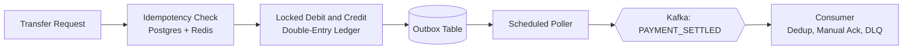

<!-- ===================== HEADER ===================== -->
<div align="center">


<a href="https://github.com/prash-spartanx">
  
</a>

<br/>


<a href="https://www.linkedin.com/in/prashant-naik-778a48291"></a>
<a href="mailto:naikprashant837@gmail.com"></a>
<a href="https://github.com/prash-spartanx"></a>

</div>

---

## 👋 About Me

I'm a **Java backend developer** who enjoys the part of software most people avoid: what happens when two requests hit the same account at the same time, when a client retries a payment, or when a message gets delivered twice.

My projects are built around those problems: **concurrency control, ACID transactions, idempotency, and event-driven architecture**, with Spring Boot, PostgreSQL, Redis and Kafka. I finished my B.Tech in Computer Science in May 2026, and alongside my studies I've been working as an **AI Response Evaluator**, which has sharpened my eye for edge cases and precise documentation.

> 💬 **My motto:** *"Make it correct first, then make it fast, and write down what you couldn't verify."*

```text
🔭 Working on   →  Distributed systems, ledgers and event-driven services
🌱 Learning     →  System design at scale, advanced Kafka patterns, cloud deployment
🤖 Also into    →  Local LLMs (Ollama), code generation, robotics with Arduino
📍 Based in     →  Bangalore, India
📫 Reach me     →  naikprashant837@gmail.com
```

---

## 🛠️ Tech Stack

<div align="center">


</div>

| Area | What I work with |
|---|---|
| **Languages** | Java, Python, SQL |
| **Backend** | Spring Boot, Spring Data JPA, Hibernate, Spring Kafka, REST APIs, JWT Authentication, FastAPI |
| **Data & Messaging** | PostgreSQL, MySQL, Redis (Redisson), Apache Kafka, Flyway |
| **Core Concepts** | Concurrency Control, ACID Transactions, Optimistic & Pessimistic Locking, Idempotency, Transactional Outbox, Event-Driven Architecture |
| **Design** | OOP, SOLID Principles, System Design Fundamentals |
| **Tools & Testing** | Docker, Docker Compose, JUnit 5, Postman, IntelliJ IDEA |
| **AI / ML** | Ollama (Local LLMs), Gemini, Groq, Scikit-learn |

---

## 🚀 Featured Projects

### 💳 Distributed Payment Settlement & Ledger Engine
`Java 21` `Spring Boot 3` `PostgreSQL` `Redis` `Kafka` `Flyway` `JUnit 5`

A payment backend where money never goes missing, even under concurrent load and duplicate requests.

- **Double-entry ledger:** every transfer is recorded as matching debit and credit entries, using `BigDecimal` and Flyway-versioned schemas.
- **Safe balances:** pessimistic row locks, optimistic locking (`@Version`) with bounded retries, and consistent lock ordering to prevent deadlocks between opposite transfers.
- **Idempotency:** request hashes, durable PostgreSQL records and Redis/Redisson reservation. A test with **20 concurrent callers sharing one key** produced exactly one balance change.
- **Transactional outbox:** a scheduled poller publishes `PAYMENT_SETTLED` events to Kafka. The consumer deduplicates processed events, acknowledges manually and routes failures to a dead-letter topic.
- **Verified:** concurrent transfers, duplicate requests, outbox publication and backlog processing, all covered by JUnit 5 integration tests.



[](https://github.com/prash-spartanx/ResilientTransactions))

---

### ⚙️ Codegen: Spec-Driven Backend Generator
`Java` `FreeMarker` `FastAPI` `PostgreSQL` `Docker` `Ollama` `Groq` `Gemini`

Write one YAML spec, get a runnable backend.

- **One spec → full backend:** a Java generator produces a FastAPI + SQLAlchemy + PostgreSQL + JWT service with a Dockerfile and Docker Compose files.
- **Fails early:** a validation pipeline (schema checks, typed mapping, cross-reference checks) rejects invalid specs before any code is written.
- **LLM-assisted logic:** 3 providers (Ollama, Groq, Gemini) write service-method logic from per-method prompts, with output cleaning, validation and up to 3 retries.
- **Tested for real:** black-box end-to-end scripts in Docker across **6 domains**. The shop API passed **55 of 55** checks and the ticket tracker passed **50 of 56**, with the remaining gaps documented.

[](https://github.com/prash-spartanx/REPLACE-WITH-CODEGEN-REPO-NAME)

---

### 🤖 Wanderer: Event-Driven Home Robot
`Spring Boot` `Python` `Kafka` `Ollama` `YOLOv8` `Whisper` `Arduino` `Docker Compose`

A home robot split into independent services that talk only through Kafka.

- **4 services, 5 Kafka topics:** a Spring Boot "brain" plus Python services for speech, vision and navigation, deployed with Docker Compose.
- **Stateful orchestrator:** tracks navigation, speech, vision and intended-mode states, pauses on the wake word, resumes safely, and classifies spoken commands into **3 intents** using a local LLM.
- **Perception stack:** wake-word detection, Whisper transcription, face recognition, YOLOv8 object detection and an ultrasonic sensor that stops the robot at **25 cm**.
- **Honest status:** tested end to end on hardware. Wheel motion is still unverified, and that's documented in the repo.

[](https://github.com/prash-spartanx/REPLACE-WITH-WANDERER-REPO-NAME)

---

## 💼 Experience

**AI Data Trainer / Response Evaluator** · *Outlier AI (Remote)* · Aug 2024 – Present

- Evaluate and score LLM responses for relevance, factual accuracy and instruction-following against task-specific guidelines.
- Identify edge cases and inconsistencies, document evaluation decisions, and apply consistent criteria across distributed workflows.

---

## 🎓 Education & Certifications

| | |
|---|---|
| 🎓 **B.Tech, Computer Science & Engineering** | Presidency University, Bangalore · 2022 – 2026 · **CGPA 8.23 / 10** |
| 🏅 **Oracle Cloud Infrastructure 2025** | Certified Generative AI Professional |
| 🏅 **Udemy** | Artificial Intelligence & Machine Learning · Deep Learning |

---

## 📊 GitHub Stats

<div align="center">


</div>

---

## 🤝 Let's Connect

I'm looking for a **Java backend / Spring Boot** role where I can work on reliable, high-integrity systems. If you're hiring, building something interesting, or just want to talk about distributed systems, get in touch.

<div align="center">

<a href="https://www.linkedin.com/in/prashant-naik-778a48291"></a>
<a href="mailto:naikprashant837@gmail.com"></a>

<br/><br/>


</div>
